# Changelog

All notable changes to this project are documented here. The project follows
[Semantic Versioning](https://semver.org/); before 1.0 the API may change
between minor versions, but the public URL scheme is frozen from 0.0.1.

## [0.1.2] — Homebrew

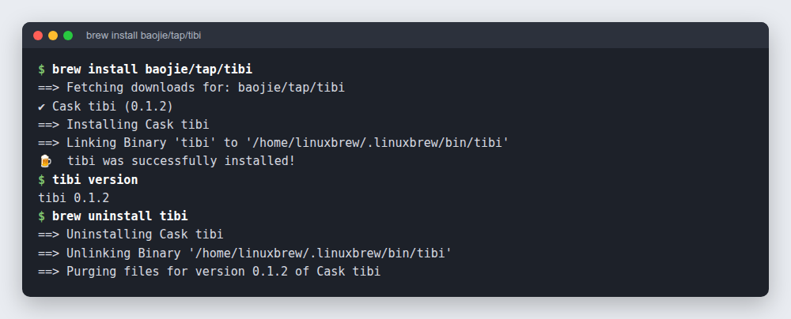

### Added
- Install with Homebrew on macOS and Linux: `brew install baojie/tap/tibi`.
  Each release updates the cask in
  [baojie/homebrew-tap](https://github.com/baojie/homebrew-tap); on macOS
  the install clears the quarantine flag, since the binaries are not
  notarized.

## [0.1.1] — First public release

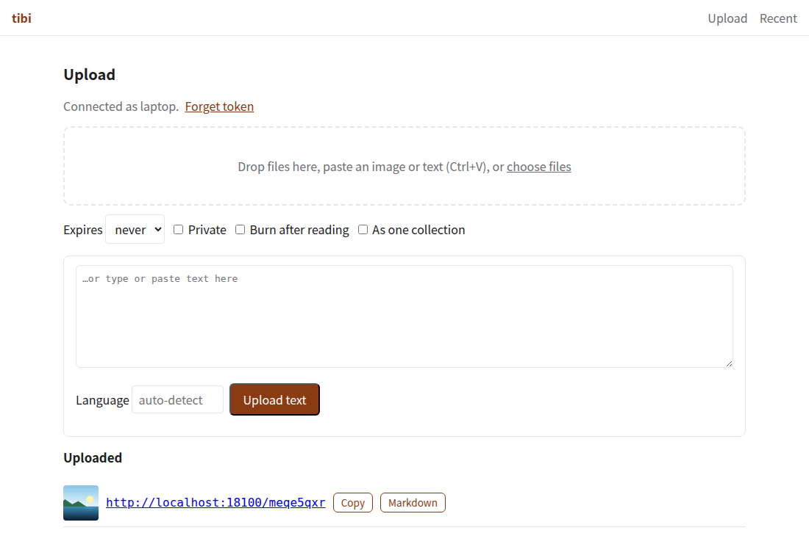

### Added
- Install with `go install github.com/baojie/tibi/cmd/tibi@latest`: the Go
  module is now `github.com/baojie/tibi`.
- A screenshot for every version, under its heading here and in the GitHub
  release notes (`docs/screenshots/`, made by `scripts/screenshots/` from
  real runs; `scripts/release-notes.sh`). A test fails when a version has
  none.

### Fixed
- Upload page: the button that copies an image's Markdown was labelled
  "Copy", like the one that copies its link; it now says "Markdown".

## [0.1.0] — Feature-complete release

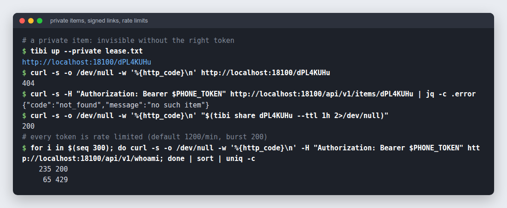

Everything PLAN.md set out to build, reviewed and hardened: image hosting
and pastes, S3/Backblaze B2 storage, media and HEIC, search, collections,
encrypted pastes, resumable uploads, cost controls, and clients for the
command line, the web, Chrome, Android, ShareX/Flameshot/PicGo, ACDSeeN
and AI agents (MCP). No new features in this release: an independent
security review of the server (A8) and the end-to-end encryption (A9),
its fixes (below, each re-verified by the reviewers), a full regression
on local disk, an S3-compatible store and a real Backblaze B2 bucket, the
documentation, and the license (AGPL-3.0-only). `docs/ACCEPTANCE.md`
records how every acceptance criterion of 0.0.1–0.0.17 is checked.

### Security
Fixes from an independent review of the security model (A8) and the
end-to-end encryption (A9); see `docs/SECURITY.md`.
- Private items are visible in the API only to tokens with `read_private`
  and to the token that uploaded them: an `upload`-only token could list,
  search, read, share, publish and (via `expires`) delete everyone's
  private items. Applies to items, search, share links, forks and
  collections.
- Making an item or collection expire sooner requires scope `delete`.
- Burn-after-read: the reveal no longer inlines the content (one request
  cost ~10× the item's size in memory); it hands out a 10-minute link.
  Encrypted burn items keep their key across the reveal and decrypt (they
  used to be destroyed unreadable). Cross-site reveals are refused; share
  links to private burn items work.
- Daily bandwidth caps reserve a response's full size when it starts
  (unsent bytes are given back), so parallel downloads — with or without
  overlapping ranges — cannot overshoot them; presigned redirect URLs last
  15 minutes (was 1 hour) and are not cached by shared caches.
- Quotas count unfinished resumable uploads (cancelled ones stop
  counting) and are checked atomically with the commit — under a lock per
  token — and again when a resumable upload completes.
- Per-token API rate limit (`rate_limit`, `rate_burst`; 429 with
  `Retry-After`), as PLAN A8.7 always specified.
- Image decompression bombs: thumbnails are limited by estimated decoded
  bytes (a 16-bit 9999×9999 PNG decoded to 800 MB; progressive JPEGs are
  recognised and counted with their coefficients) and made one at a time; HEIC
  converters get the input format named explicitly, memory limits, and
  run two at a time.
- Multipart uploads: at most 100 files and 50 fields per request (20 000
  parts held 40 000 file descriptors open).
- Search no longer crashes on pastes with characters whose lower case is
  longer in UTF-8 (Ⱥ); the case-insensitive snippet match is linear.
- Search cannot stall the server: it runs on separate read-only database
  connections (two at a time), words are limited to 64 characters, and a
  query is interrupted after 5 seconds (a long word over large repetitive
  pastes held the single connection, and every page view, for 15 s).
- Expiries are capped at 100 years (`1e300d` overflowed into the past).
- Hotlink protection covers `/dl` of media.
- `/metrics` needs an admin token unless `metrics_allow_local` is set (a
  same-machine reverse proxy made every request look local).
- S3 objects of active types are stored as `application/octet-stream`;
  the database file is created 0600; `/static/` lists no directories.
- Browser decryption: downloads are always `application/octet-stream`,
  inline display is limited to raster images and media, PBKDF2 iteration
  counts are bounded, malformed headers give an error instead of a blank
  page. `internal/e2e` no longer panics on 32-bit platforms for huge
  header lengths. MCP's `paste_text` says that titles are not encrypted.

### Behaviour changes
- `/metrics` without a token from localhost now needs
  `metrics_allow_local = true`.
- `upload`-only tokens no longer see other tokens' private items.
- Shortening `expires` needs scope `delete`.

### Added
- `docs/SECURITY.md` (security model and reporting), `docs/ACCEPTANCE.md`
  (every acceptance criterion and where it is checked), `LICENSE`
  (AGPL-3.0-only).

### Changed
- Android: sharing opens a small dialog with the upload's progress and then
  the link itself, with Open, Copy and Share — not just a toast and a
  notification that is easy to miss. Hiding it does not stop the upload.
  The main screen lists recent links (tap copies, Share sends).

## [0.0.17] — ACDSeeN integration

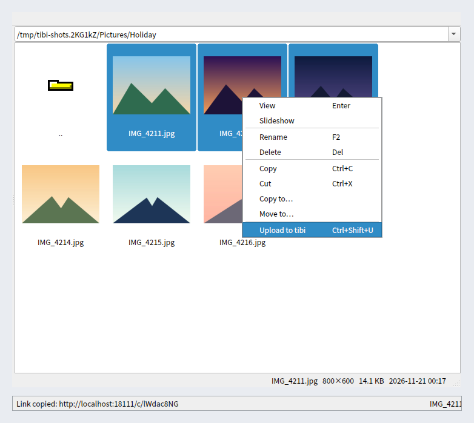

PLAN's "adseen" turned out to be ACDSeeN, a desktop image viewer with no
database, so the integration is an upload action rather than an asset
pipeline: there are no records to store links back into.

### Added
- ACDSeeN (separate repository): **Upload to tibi** in its File and
  right-click menus, shown only when the tibi CLI is logged in on the
  machine; one image → item link, several → collection link, copied to the
  clipboard; `source=acdseen`. No tibi changes were needed: raw upload,
  `POST /api/v1/collections` and `GET /api/v1/items?source=` already cover
  it (checked end to end against a real server).
- `docs/CLIENTS.md`: ACDSeeN section.

## [0.0.16] — Android app

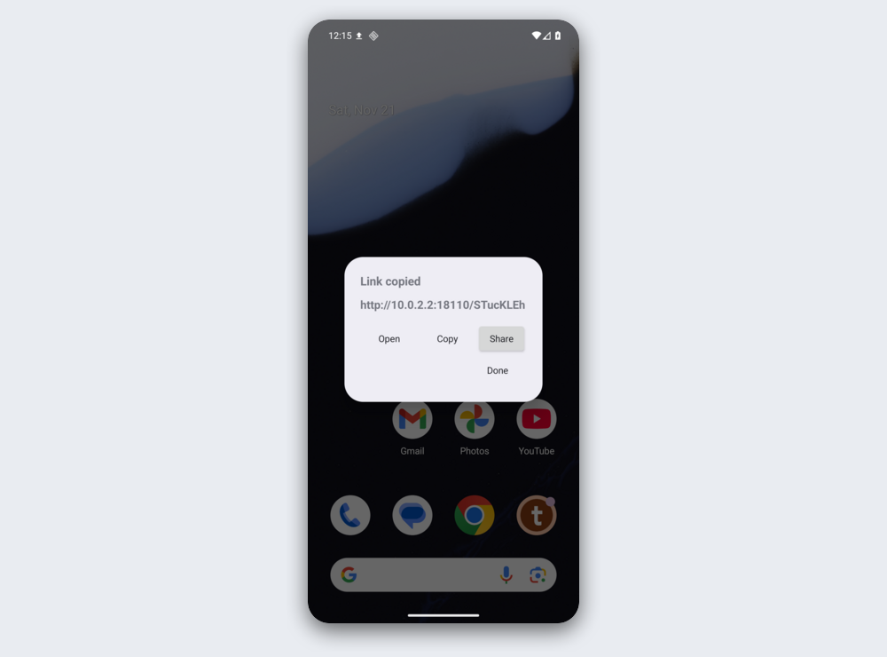

### Added
- `android/`: share target for images, videos, text and any file
  (`ACTION_SEND`, `ACTION_SEND_MULTIPLE`); shared content is copied into
  the app's outbox and uploaded by WorkManager over tus, with progress saved
  after every step: a lost network (airplane mode) pauses the upload and it
  resumes from the server's offset. Link copied; notification with Copy and
  Share; several items → one collection; Quick Settings tile for the newest
  screenshot; settings screen with a connection test. English and Chinese.
  `source=android`.
- `android/scripts/emulator-test.sh` and a CI job running it on an
  emulator: one photo (link read back from the clipboard), five photos →
  one collection in order, airplane mode mid-upload (resumes; nothing sent
  twice), HEIC served as JPEG, the Quick Settings tile.

## [0.0.15] — Chrome extension

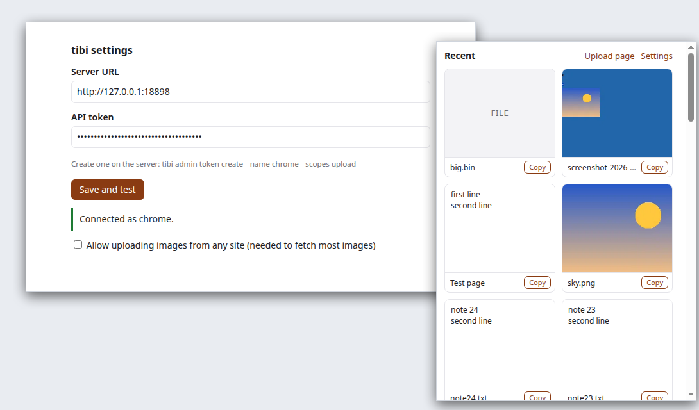

### Added
- `extensions/chrome/` (Manifest V3): right-click image → upload,
  selection → text paste (line breaks kept, page title), page → visible
  screenshot; link copied to the clipboard and shown in a notification;
  popup with recent items; options page with a connection test that names
  the origin to add to `cors_origins`. `source=chrome`, `meta.page_url`;
  tus above 20 MiB. English and Chinese.
- The extension's API client uses types and endpoints generated from
  `api/openapi.yaml` (`go run ./tools/apidoc -js`; checked in CI).
- CORS for `/api/` driven by `cors_origins` (and `TIBI_CORS_ORIGINS`):
  preflights, tus headers exposed; nothing for unlisted origins.
- `TIBI_ALLOWED_REFERERS` environment variable.
- Browser test: the unpacked extension in Chrome against a server that
  allows only its origin — image, selection, screenshot (clipboard read
  back), a 21 MiB tus upload, popup and options.

## [0.0.14] — End-to-end encrypted pastes

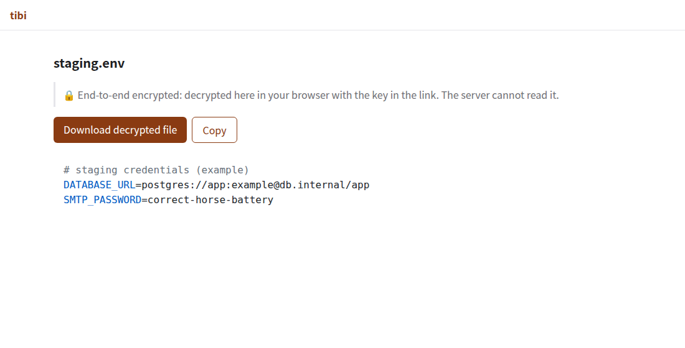

### Added
- `kind=encrypted` items: client-side AES-256-GCM, key in the URL fragment
  (`#k=…`, never sent to the server), optional password
  (HKDF(key ‖ PBKDF2-SHA256(password, 600 000 iterations))). Versioned
  format (first byte); header authenticated; file name and type inside the
  ciphertext. Specified in `api/openapi.yaml`, implemented in
  `internal/e2e`.
- The server stores encrypted items as opaque bytes: format checked, no
  sniffing, metadata stripping, thumbnails, search indexing or link
  previews; a client-sent file name is dropped. Burn-after-read works (the
  ciphertext is embedded in the reveal page).
- Browser decryption with WebCrypto (`/static/e2e.js`): text highlighted
  client-side with bundled highlight.js 11.11.1 (BSD-3-Clause), images and
  media shown, every type downloadable decrypted; password prompt; clear
  messages for a missing key, a wrong key, a wrong password or an unknown
  format (translated).
- CLI: `--encrypt` and `--password` for `paste`, `up` and `clip`; MCP
  `paste_text(encrypt=true)`.
- Browser end-to-end test: CLI-encrypted text, password-protected text and
  an image decrypt in Chrome; missing/wrong key and wrong password errors.

### Fixed
- Elements with the `hidden` attribute could still show when a stylesheet
  set their `display` (the owner navigation appeared without a token).

## [0.0.13] — Resumable uploads

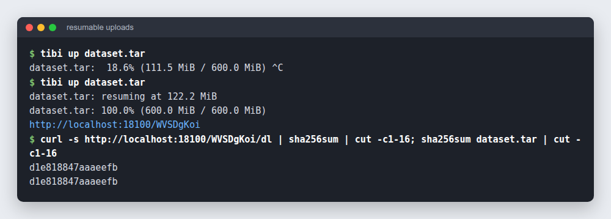

### Added
- tus 1.0 resumable uploads at `/api/v1/uploads/` (tusd v2): options in
  `Upload-Metadata`, validated (and the quota checked) at creation; limit
  `max_resumable_bytes` (default 2 GiB). Only the creating token can see or
  continue an upload. The final PATCH runs the ingest pipeline (moving the
  file, not copying it) and answers with `Tibi-Item-Id`/`Tibi-Item-Url`;
  `GET /api/v1/uploads/{id}/item` returns the item (409 while incomplete).
- Unfinished uploads are discarded after 24 hours (every GC pass).
- The CLI uploads files over 20 MiB with tus, 16 MiB per request, with a
  progress line on stderr; re-running the same command after an
  interruption continues from the server's offset (state in
  `~/.cache/tibi/uploads`). Transient network errors are retried.
- `tibi_resumable_received_bytes_total` metric.
- Verified with a real 500 MiB upload killed with SIGKILL halfway: the
  re-run sent only the remaining 248 MiB and the item is byte-identical.

## [0.0.12] — MCP server

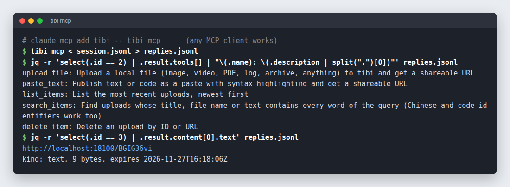

### Added
- `tibi mcp`: a Model Context Protocol server on stdio (protocol versions
  2024-11-05, 2025-03-26 and 2025-06-18) using the CLI's login. Tools:
  `upload_file`, `paste_text`, `list_items`, `search_items`, `delete_item`,
  with descriptions, input schemas, annotations (read-only / destructive)
  and structured results. Uploads are tagged `source=mcp`.
- Bad tokens, oversized files, unknown languages, missing files and an
  unreachable server are returned as tool errors (`isError`) with an
  actionable message; protocol errors use JSON-RPC codes; the session keeps
  working after any of them.
- `docs/CLIENTS.md`: setup for Claude Code, Claude Desktop and other MCP
  clients. Verified with the official MCP TypeScript SDK client.

## [0.0.11] — Packaging and ecosystem

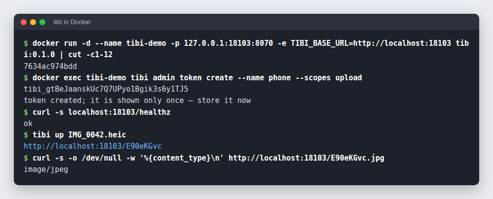

### Added
- GoReleaser configuration: binaries for linux/amd64, linux/arm64,
  darwin/arm64 and windows/amd64 (pure Go, no cgo), archives with docs and
  integrations, checksums, `.deb` packages, a multi-arch image on GHCR and
  a Homebrew cask. The release workflow is switched off until the
  repository variable `RELEASE_ENABLED` is `true`; CI builds a snapshot and
  the Docker image on every push without publishing.
- `.deb`: hardened systemd unit (`ProtectSystem=strict`, own state
  directory), `tibi` system user, `/etc/tibi/server.toml`, docs; recommends
  `libvips-tools` and the libde265 HEIF plugin for HEIC conversion.
- `Dockerfile`: Debian trixie with `vips` and the HEVC decoder, non-root
  (uid 10001), data in `/data`.
- Integrations: ShareX custom uploader (`integrations/sharex/tibi.sxcu`),
  Flameshot script (`integrations/flameshot/tibi-shot`), and the
  `picgo-plugin-tibi` uploader for PicGo/PicList (tested against PicGo core
  1.8).
- `docs/CLIENTS.md`: CLI, curl, web page, ShareX, Flameshot, PicGo/PicList.
- `go run ./tools/apidoc -check` fails when `docs/API.md` is stale (run
  before every release build).

## [0.0.10] — Operations: cost control, metrics, export

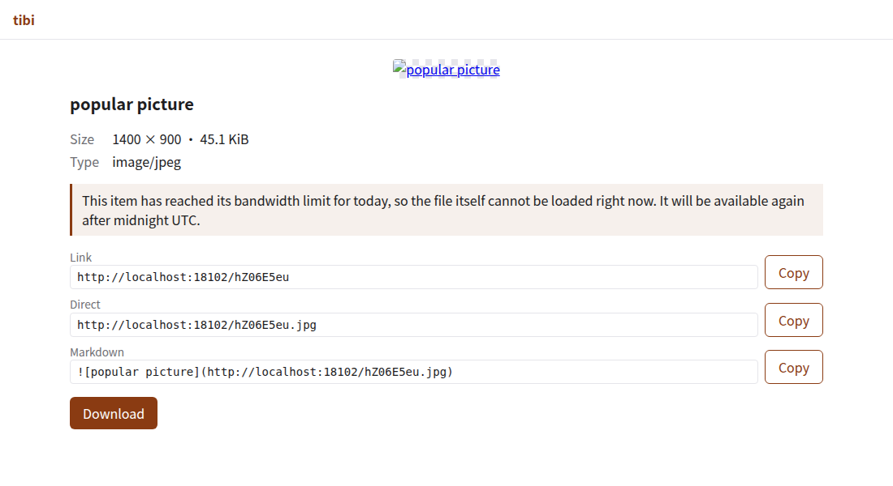

### Added
- Traffic counters: `view_count` (view pages and first-range raw hits) and
  `bytes_served` per item, plus per-day totals, kept in memory and written
  in batches every 10 seconds and at shutdown.
- Daily bandwidth caps per item and per instance
  (`max_item_bytes_per_day`, `max_total_bytes_per_day`): raw, download and
  thumbnail URLs answer `429` with `Retry-After` until midnight UTC; the
  view page explains (translated).
- Hotlink protection for images, video and audio (`allowed_referers`,
  with `*.example.com` wildcards); empty referers and tibi's own pages are
  always allowed.
- Per-token upload quotas (`--quota`), enforced on uploads, multipart
  uploads and forks with a `413` that states the numbers; `whoami` reports
  `used_bytes`.
- `/metrics` in Prometheus format (admin token, or a direct local
  connection; never through a proxy), `GET /api/v1/stats` (admin) and
  `tibi admin stats`.
- `tibi admin export` / `tibi admin import`: a `.tar.zst` with live items,
  collections, tokens, blobs, thumbnails and the share-link key; import
  into an empty instance (any backend) reproduces every URL byte for byte,
  verifies each blob's hash and rebuilds the search index.
- `docs/DEPLOY.md`: limits, monitoring, and backups with Litestream.

## [0.0.9] — Web experience

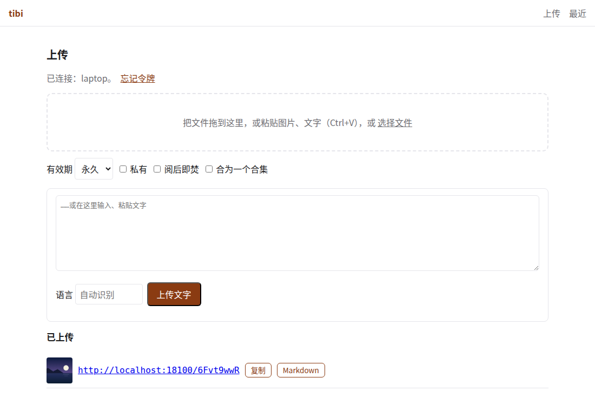

### Added
- `/upload`: the owner's upload page. Connect once with an API token (kept
  in the browser's local storage, verified with `whoami`), then drag and
  drop, pick files, or paste screenshots/images straight from the
  clipboard; type or paste text pastes with an optional language. Options:
  expiry, private, burn after reading, upload as one collection. Results
  with copy buttons; upload progress.
- `/recent`: newest items (or search results) with thumbnails, select all,
  bulk delete, load more. Private thumbnails load with the token.
- OpenGraph and Twitter card tags on view and collection pages, so links
  unfurl in Slack, Discord, Telegram, etc. — never for private,
  burn-after-read or encrypted items (nor through share links).
- Signed share links: `POST /api/v1/items/{id}/share-link?ttl=1h` and
  `tibi share ID [--ttl]` return an HMAC-signed URL that opens a private
  item (page, raw, download, thumbnail) until it expires, never past the
  item's own expiry. The key is created on first start
  (`secret_key_file`, default `data_dir/secret.key`, mode 0600).
- Internationalized UI: every page string lives in `web/i18n/*.toml`;
  English and Simplified Chinese ship. The locale follows
  `Accept-Language` (fallback `default_locale`); page scripts get their
  strings through a data attribute (no inline scripts). A test keeps the
  catalogs complete.
- The Fork button on text pages now appears in browsers connected on the
  upload page.
- A real-browser end-to-end test (Chrome via the DevTools protocol, no
  dependencies) pastes an image into `/upload` and checks the resulting
  link; it runs in CI.

## [0.0.8] — Collections and forks

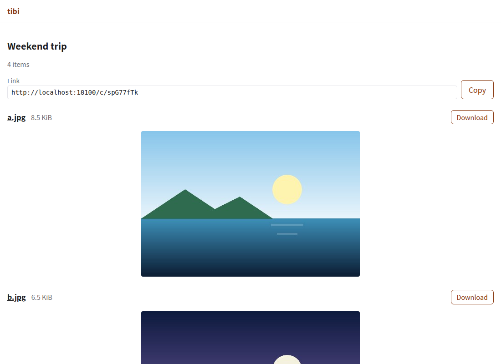

### Added
- Collections (albums and multi-file pastes) sharing the item ID namespace:
  `POST/GET /api/v1/collections`, `GET/PATCH/DELETE /api/v1/collections/{id}`
  (title, visibility, expiry, reorder by listing item IDs). Deleting a
  collection deletes its items.
- Uploads with `collection=new` (plus `collection_title`) put all files
  into a new collection in order; `collection=<id>` appends. The response
  is `{"collection": …, "items": […]}`. Items carry `collection_id`,
  `collection_url` and `position`; `GET /api/v1/items?collection=` filters.
- `/c/{id}` page: a thumbnail grid for all-image albums, otherwise every
  item stacked in order (images, players, highlighted code with per-file
  line links such as `#f2-L20-L24`, rendered Markdown). Private
  collections need a `read_private` token.
- Forks: `POST /api/v1/items/{id}/fork` creates a new version with
  `forked_from` (title, filename, lang and visibility default to the
  original's); the original never changes. Item pages link to what they
  were forked from and to their collection. Text pages have a Fork editor
  for browsers that hold an API token (stored by the upcoming web upload
  page).
- CLI: `tibi up --album FILE...` prints one collection URL; `tibi fork ID
  [FILE|-]` (opens `$EDITOR` prefilled with the original when no input is
  given); `tibi rm` accepts collection URLs.

### Fixed
- Copy and fork buttons fetch raw text from the page's own origin, so they
  also work when `raw_base_url` is a separate domain.

## [0.0.7] — Search and API contract

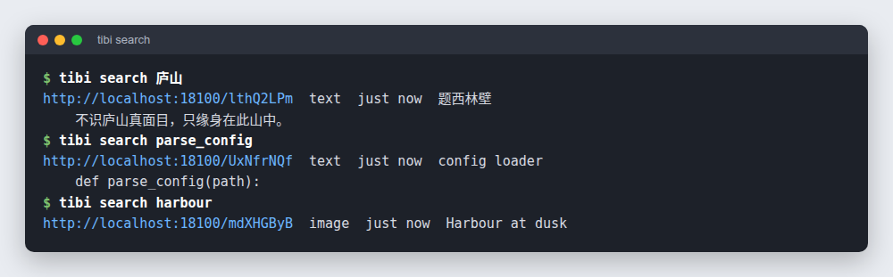

### Added
- Full-text search over titles, filenames and text content (first 1 MiB):
  `GET /api/v1/search?q=…` and `tibi search`. Every word must match; words
  of three or more characters match anywhere (identifier substrings, via an
  FTS5 trigram index); Chinese, Japanese and Korean match any substring,
  including one or two characters (CJK bigrams); case-insensitive. Results
  are newest first, paginated, with a snippet of the matching line. Deleted,
  expired and encrypted items never appear.
- Existing items are indexed automatically when the server starts.
- `api/openapi.yaml` now documents every endpoint and response. The test
  suite validates every API response against it (types, required fields,
  undocumented fields, status codes, content types) and fails if any
  documented response is never exercised.
- `docs/API.md`, generated from the spec (`go run ./tools/apidoc`); a test
  fails when it is out of date.

## [0.0.6] — Media: video, audio, HEIC, thumbnails

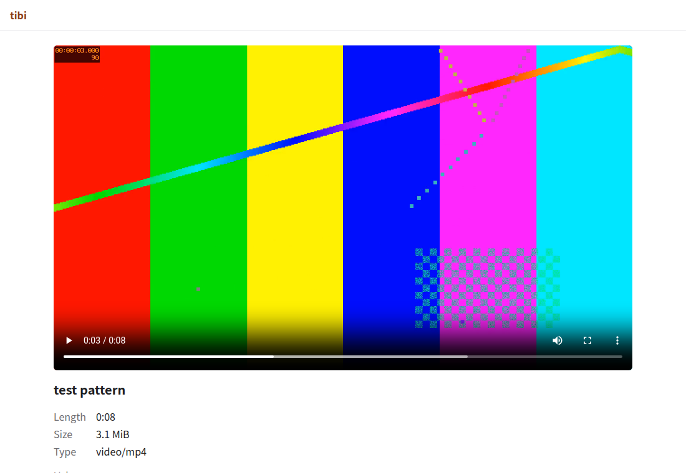

### Added
- `video` (MP4, WebM, MOV) and `audio` (MP3, Ogg, Opus, M4A, WAV, FLAC) kinds
  with inline players; seeking uses `Range`. `duration_ms` for MP4/MOV/M4A
  and WAV (read from the container header, also when `moov` is at the end).
- HEIC/HEIF photos are converted to JPEG with an external tool —
  `heic_converter = "auto"` tries `vips`, `heif-convert`, `magick` — or a
  custom command path. The original type is kept as `orig_mime`; the
  converted JPEG has its metadata (and orientation, already applied to the
  pixels) removed. Without a converter, or when conversion fails, the photo
  is stored as-is and offered for download with a note.
- WebP thumbnails (400px wide, EXIF orientation applied) for PNG, JPEG, GIF
  and WebP images, generated on upload, shared between identical images,
  served at `/{id}/thumb` (`thumbnail_url`) and garbage-collected with their
  image. Encoding is pure Go (libwebp via purego when present, WASM
  otherwise).

### Changed
- Matroska (`.mkv`) files are labelled `video/x-matroska` instead of
  `video/webm` and stored as files.

## [0.0.5] — Object storage: S3 / Backblaze B2

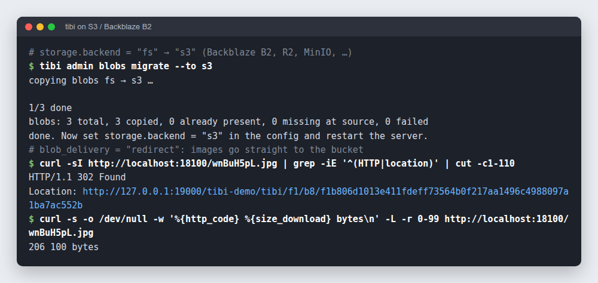

### Added
- `s3` blob backend for any S3-compatible store (AWS S3, Backblaze B2,
  Cloudflare R2, MinIO, …) via minio-go: private objects with type and
  immutable caching headers, seekable reads for `Range`.
- Startup probe (write, read, delete) that fails fast on misconfiguration.
- `blob_delivery = "redirect"`: 302 to one-hour presigned URLs for passive
  media and downloads; text, active types, private and burn-after-read items
  stay proxied.
- `tibi admin blobs migrate --to s3|fs`: verified, idempotent, resumable copy
  of all referenced blobs; raw URLs are unchanged.
- `tibi admin gc --orphans`: deletes stored blobs no item references (older
  than an hour).
- The server refuses a world-readable config file that contains S3 keys.
- `docs/DEPLOY.md` (configuration, S3/B2 setup, delivery modes, migration).
- CI runs the whole suite a second time against an S3-compatible server;
  `scripts/test-s3.sh` does the same locally. Verified manually against a
  real Backblaze B2 bucket.

### Fixed
- Deleting a blob from a versioned bucket (Backblaze B2's default) removes
  all of its versions; previously only a delete marker was added and the
  bytes stayed stored and billed.
- Expiry times are rounded up to the next second, so an item never expires
  before its requested lifetime (a `1s` expiry could previously last ~0s).

## [0.0.4] — Item management and lifecycle

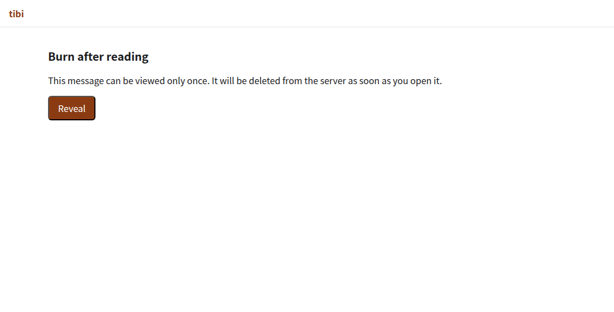

### Added
- `GET /api/v1/items` (newest first, cursor pagination, `kind`/`source`
  filters), `GET`, `PATCH` (title, lang, visibility, expires, slug — never
  content) and `DELETE /api/v1/items/{id}` (scope `delete`, soft delete).
- Expiry: `expires` on upload or patch (`10m`, `1h`, `7d`, `30d`, `never`,
  …); server `default_expires` and client `default_expires` defaults.
  Expired items 404 at once.
- Garbage collection every 10 minutes (and `tibi admin gc`): expired items
  and items deleted more than a day ago are purged, then blobs nothing
  references. Uploads and GC are serialized per blob so a blob is never
  deleted under a concurrent upload of the same content.
- Private items: served only to requests with a `read_private` token; 404
  otherwise, indistinguishable from missing items. `Cache-Control:
  private, no-store`.
- Custom slugs: `/s/{slug}` redirects to the item; slugs are pointers that
  move on reassignment; reserved words are rejected; deletion releases them.
- Burn after reading: unprivileged visitors get a "reveal" page (link
  previewers' GETs and raw prefetches consume nothing); the POST reveal shows
  the item once (images inlined, files downloaded) and deletes it. Concurrent
  reveals: exactly one succeeds.
- Raw responses of expiring items are cacheable only until expiry.
- View pages show expiry, private and burn notices.
- CLI: `tibi ls`, `info`, `rm`, `open`, `slug`; upload flags `-e/--expire`,
  `-p/--private`, `--slug`, `--burn`. Commands accept item IDs or URLs.

### Fixed
- Items uploaded within the same second now list in upload order.

## [0.0.3] — Pastebin core

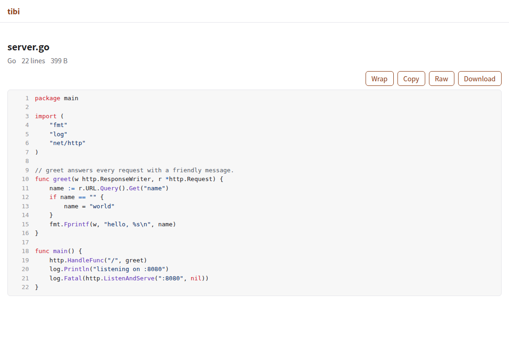

### Added
- Text view page: server-side syntax highlighting (chroma) with line numbers,
  `#L12` and `#L12-L20` line links (shift-click selects a range), wrap
  toggle, copy-all, raw and download. Light and dark themes.
- Markdown pastes render (GFM, highlighted code blocks) with a
  rendered/source toggle; raw HTML and dangerous link schemes are dropped.
- Language inference: `lang` option > file extension > content (shebangs,
  JSON, diffs, Go, Python, Rust, C, JS, SQL, Dockerfile, Makefile, Markdown,
  …) > plain text. Item responses include `lang`; pastes without a filename
  get a matching extension (`/{id}.py`).
- Charset detection and transcoding to UTF-8 for GBK/GB18030, Big5,
  Shift_JIS, EUC-JP, EUC-KR, Latin-1 and UTF-16 with BOM; the original charset
  is recorded as `charset` and shown on the view page. Raw downloads serve the
  transcoded UTF-8 (the original bytes are not kept).
- Large text: the view shows the first `max_text_bytes` (default 2 MiB) with
  a link to the full raw text; highlighting applies up to 256 KiB.
- Rendered text views are cached in memory (content is immutable).
- CLI: `tibi paste [-l LANG] [-t TITLE]` reads stdin or opens `$EDITOR`;
  `-l/--lang` on all upload commands.

## [0.0.2] — Image hosting core

### Added
- Content sniffing and kind classification: PNG, JPEG, GIF, WebP and AVIF
  are `image`; valid UTF-8 text (no NUL) is `text`; SVG, HTML, XHTML and
  JavaScript are always `file`; everything else is `file`. Clients may force
  `kind=text|file`.
- Multipart uploads: several `file` parts in one request return an array.
  Form fields may appear before or after the files.
- Lossless metadata stripping for JPEG (EXIF incl. GPS, XMP, IPTC, comments,
  trailing MPF images), PNG (`eXIf`, `tEXt`, `zTXt`, `iTXt`, `tIME`) and WebP
  (`EXIF`, `XMP `). JPEG orientation is preserved as a minimal EXIF block.
  Opt out per upload with `keep_meta=1` or globally with
  `strip_image_meta = false`.
- Image dimensions (`width`, `height`, display-oriented) and a `markdown`
  field in item responses.
- Image view page with the picture and copy buttons for link, direct URL and
  Markdown (external script, no inline JS).
- CLI: `--md`, `--raw`, `--keep-meta`, `--no-copy`; results are copied to the
  clipboard when stdout is a terminal (Wayland, X11, macOS); `tibi clip`
  uploads the clipboard, preferring an image over text.

### Changed
- Images always use the extension of their detected type in `raw_url`
  (a PNG named `shot.jpg` is served at `/{id}.png`).

## [0.0.1] — Walking skeleton

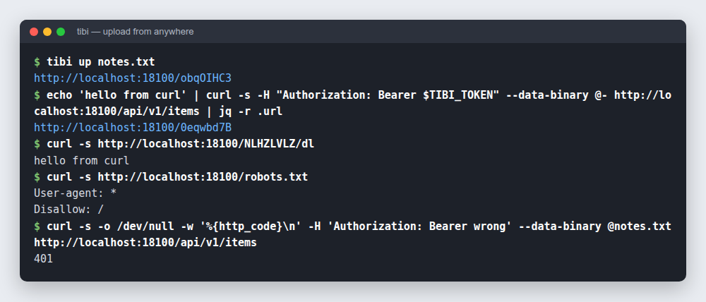

### Added
- Single `tibi` binary: `tibi serve`, `tibi admin`, and the client CLI.
- Server config from TOML (`/etc/tibi/server.toml` or `--config`) with
  `TIBI_*` environment overrides.
- SQLite metadata store (pure Go, WAL) with forward-only embedded migrations.
- Content-addressed `fs` blob store (`ab/cd/<sha256>`, atomic writes, dedup).
- API tokens: `tibi admin token create|list|revoke`; tokens are stored hashed
  and scoped (`upload`, `read_private`, `delete`, `admin`).
- `POST /api/v1/items` raw-body upload (options via query or `X-Tibi-*`
  headers), stored as kind `file`; `GET /api/v1/whoami`;
  `GET /api/v1/openapi.yaml`; `GET /healthz`.
- Frozen public URL scheme: `/{id}`, `/{id}.{ext}`, `/{id}/raw`, `/{id}/dl`.
- Security headers: active content (HTML, SVG, XHTML, JS, XML) is never served
  with its real type; `nosniff` everywhere; sandbox CSP on raw routes, strict
  CSP on view pages; `X-Robots-Tag: noindex` on every response and a
  disallow-all `/robots.txt`.
- Size limit (`max_upload_bytes`) enforced while streaming → 413.
- CLI: `tibi login`, `tibi up FILE...`, `tibi up -`, and `<cmd> | tibi`;
  stdout carries only URLs, `--json` prints API responses.
- `api/openapi.yaml` contract (started) and CI (gofmt, vet, build, race tests).
